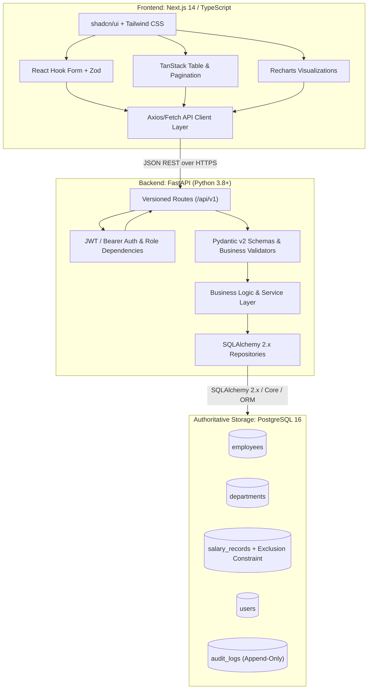
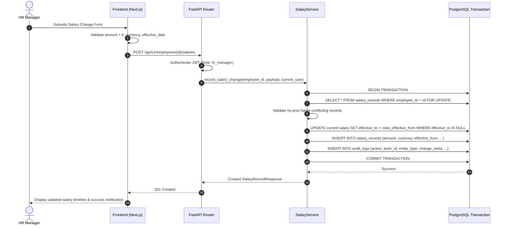

# ACME Employee Salary Management System - Architecture

## 1. High-Level Architecture Overview

The system follows a clean, decoupled client-server architecture with an authoritative PostgreSQL relational database.

## 2. Component Breakdown

### Frontend (Next.js 14 App Router + TypeScript)
- **Role:** Delivers a responsive, accessible, dark/light-mode enterprise HR SaaS experience.
- **Key Modules:**
  - `app/(auth)/login`: Secure credentials authentication with CSRF/token management.
  - `app/(dashboard)/page`: Executive HR Analytics Dashboard with KPI stat cards, Recharts visualizations, and filter controls.
  - `app/(dashboard)/employees`: TanStack table with server-side pagination, search, column sorting, and multi-filter dropdowns.
  - `app/(dashboard)/employees/[id]`: Employee profile details, salary timeline, and salary action triggers.
  - `components/salary/SalaryChangeDialog`: Modal form for recording salary changes with confirmation step, reason classification, and live client validation.
  - `lib/api`: Centralized, typed API client handling auth headers, error propagation, and response unwrapping.

### Backend (FastAPI + SQLAlchemy 2.0)
- **Role:** Enforces business logic, authentication, transactional integrity, database aggregations, and streaming responses.
- **Key Subsystems:**
  - `api/routes`: REST endpoints under `/api/v1/auth`, `/api/v1/employees`, `/api/v1/salaries`, `/api/v1/analytics`, `/api/v1/reports`.
  - `core/security`: Password hashing (bcrypt), JWT generation/validation, token expiration, secret management.
  - `services/employee_service`: Employee search query builder, filtering, profile retrieval.
  - `services/salary_service`: Effective-dating state machine, period adjustment, no-overlap validation, transactional audit creation.
  - `services/analytics_service`: Direct PostgreSQL SQL aggregation (AVG, `percentile_cont(0.5)`, SUM by currency) without fetching 10,000 entities into memory.
  - `services/export_service`: Memory-conscious streaming CSV generation for employee reports.

### Authoritative Database (PostgreSQL 16)
- **Schema & Migrations:** Managed strictly via Alembic.
- **Data Integrity:** Foreign keys, unique constraints on employee numbers and user emails, check constraints on salary amounts (`amount > 0`), and exclusion constraints preventing overlapping date ranges (`daterange(effective_from, coalesce(effective_to, 'infinity'))`).

## 3. Request & Data Flows

### A. Recording a Salary Change

### B. Analytics Aggregation Flow
Instead of loading 10,000 records into application memory:
1. Client sends filter parameters: `?country=US&department_id=1&currency=USD`.
2. Backend generates a single parameterized query joining `employees` with active `salary_records` (`effective_to IS NULL`).
3. Aggregations run directly on PostgreSQL:
   - Total payroll: `SUM(amount)` grouped by `currency`
   - Average: `AVG(amount)`
   - Median: `percentile_cont(0.5) WITHIN GROUP (ORDER BY amount)`
4. Fast response (< 50ms) returned to client for chart rendering.
