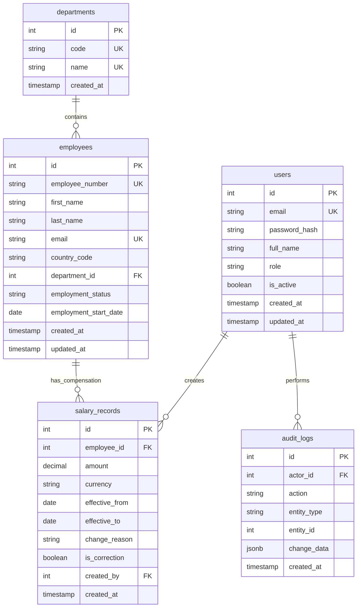

# ACME Employee Salary Management System - Data Model

## 1. Relational Entity Relationship Diagram



## 2. Table Specifications

### A. `users`
Represents administrative operators (HR Managers, System Administrators).
- `id`: `INTEGER PRIMARY KEY GENERATED ALWAYS AS IDENTITY`
- `email`: `VARCHAR(255) NOT NULL UNIQUE` (indexed)
- `password_hash`: `VARCHAR(255) NOT NULL` (bcrypt hashed)
- `full_name`: `VARCHAR(255) NOT NULL`
- `role`: `VARCHAR(50) NOT NULL DEFAULT 'hr_manager'`
- `is_active`: `BOOLEAN NOT NULL DEFAULT TRUE`
- `created_at`: `TIMESTAMP WITH TIME ZONE NOT NULL DEFAULT NOW()`
- `updated_at`: `TIMESTAMP WITH TIME ZONE NOT NULL DEFAULT NOW()`

### B. `departments`
Enterprise organizational divisions (e.g., Engineering, Human Resources, Sales, Marketing, Finance, Product, Operations, Legal).
- `id`: `INTEGER PRIMARY KEY GENERATED ALWAYS AS IDENTITY`
- `code`: `VARCHAR(20) NOT NULL UNIQUE`
- `name`: `VARCHAR(100) NOT NULL UNIQUE`
- `created_at`: `TIMESTAMP WITH TIME ZONE NOT NULL DEFAULT NOW()`

### C. `employees`
Identity and employment status for 10,000 workforce members. Kept completely decoupled from compensation values.
- `id`: `INTEGER PRIMARY KEY GENERATED ALWAYS AS IDENTITY`
- `employee_number`: `VARCHAR(30) NOT NULL UNIQUE` (e.g. `ACM-000001` to `ACM-010000`, B-tree indexed)
- `first_name`: `VARCHAR(100) NOT NULL`
- `last_name`: `VARCHAR(100) NOT NULL`
- `email`: `VARCHAR(255) NOT NULL UNIQUE` (B-tree indexed)
- `country_code`: `VARCHAR(2) NOT NULL` (ISO 3166-1 alpha-2, e.g. `US`, `GB`, `DE`, `CA`, `IN`, `AU`, `SG`, `JP`, indexed)
- `department_id`: `INTEGER NOT NULL REFERENCES departments(id) ON DELETE RESTRICT` (indexed)
- `employment_status`: `VARCHAR(30) NOT NULL DEFAULT 'ACTIVE'` (`ACTIVE`, `TERMINATED`, `ON_LEAVE`, indexed)
- `employment_start_date`: `DATE NOT NULL`
- `created_at`: `TIMESTAMP WITH TIME ZONE NOT NULL DEFAULT NOW()`
- `updated_at`: `TIMESTAMP WITH TIME ZONE NOT NULL DEFAULT NOW()`

**Indexes:**
- `idx_employees_number`: `ON employees (employee_number)`
- `idx_employees_country_dept`: `ON employees (country_code, department_id, employment_status)`
- `idx_employees_names`: `ON employees (last_name, first_name)`

### D. `salary_records`
Effective-dated compensation ledger.
- `id`: `INTEGER PRIMARY KEY GENERATED ALWAYS AS IDENTITY`
- `employee_id`: `INTEGER NOT NULL REFERENCES employees(id) ON DELETE CASCADE` (indexed)
- `amount`: `NUMERIC(14, 2) NOT NULL CHECK (amount > 0)`
- `currency`: `VARCHAR(3) NOT NULL` (ISO 4217: `USD`, `EUR`, `GBP`, `CAD`, `INR`, `AUD`, `SGD`, `JPY`)
- `effective_from`: `DATE NOT NULL`
- `effective_to`: `DATE NULL` (NULL denotes current, open-ended compensation)
- `change_reason`: `VARCHAR(100) NOT NULL` (`INITIAL_OFFER`, `MERIT_INCREASE`, `PROMOTION`, `MARKET_ADJUSTMENT`, `ROLE_CHANGE`, `CORRECTION`)
- `is_correction`: `BOOLEAN NOT NULL DEFAULT FALSE`
- `correction_notes`: `TEXT NULL`
- `created_by`: `INTEGER NULL REFERENCES users(id) ON DELETE SET NULL`
- `created_at`: `TIMESTAMP WITH TIME ZONE NOT NULL DEFAULT NOW()`

**Constraints & Rules:**
- Check constraint: `CHECK (effective_to IS NULL OR effective_to > effective_from)`
- Exclusion Constraint: In PostgreSQL with `btree_gist` extension, we enforce:
  ```sql
  CREATE EXTENSION IF NOT EXISTS btree_gist;
  ALTER TABLE salary_records
  ADD CONSTRAINT exclude_overlapping_salaries
  EXCLUDE USING gist (
      employee_id WITH =,
      daterange(effective_from, COALESCE(effective_to, 'infinity'::date), '[)') WITH &&
  );
  ```
  This guarantees mathematical certainty that no employee can ever have two effective salaries overlapping in time.
- Partial Index for current active salary:
  ```sql
  CREATE INDEX idx_salary_current ON salary_records (employee_id) WHERE effective_to IS NULL;
  ```

### E. `audit_logs`
Immutable append-only ledger tracking sensitive modifications.
- `id`: `INTEGER PRIMARY KEY GENERATED ALWAYS AS IDENTITY`
- `actor_id`: `INTEGER NULL REFERENCES users(id) ON DELETE SET NULL`
- `action`: `VARCHAR(50) NOT NULL` (`SALARY_CREATE`, `SALARY_UPDATE`, `SALARY_CORRECTION`, `USER_LOGIN`)
- `entity_type`: `VARCHAR(50) NOT NULL` (`salary_record`, `employee`, `user`)
- `entity_id`: `INTEGER NOT NULL`
- `change_data`: `JSONB NOT NULL` (structured metadata with previous values, new values, reason, avoiding secrets)
- `ip_address`: `VARCHAR(45) NULL`
- `created_at`: `TIMESTAMP WITH TIME ZONE NOT NULL DEFAULT NOW()`
